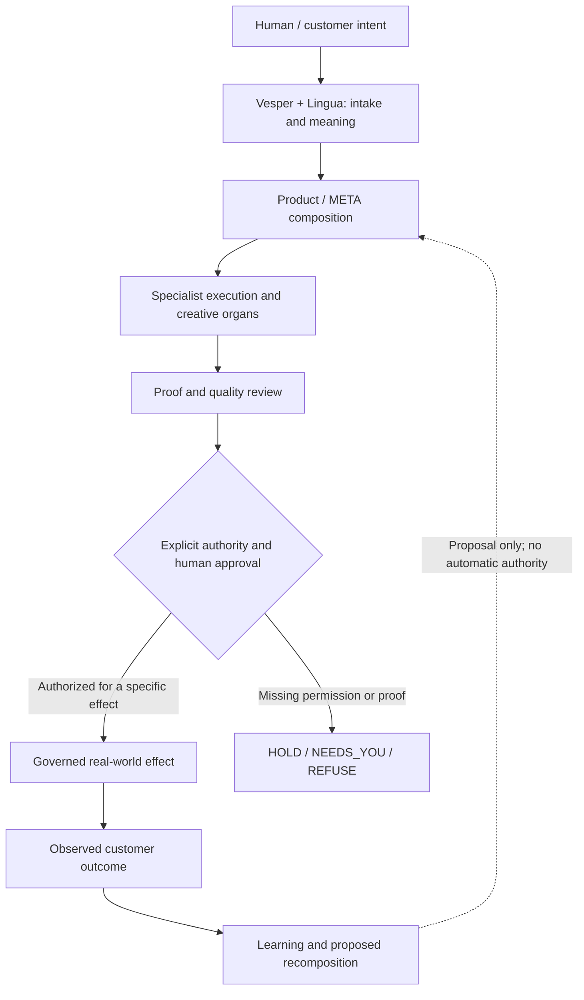
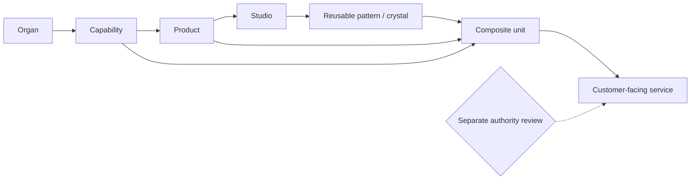
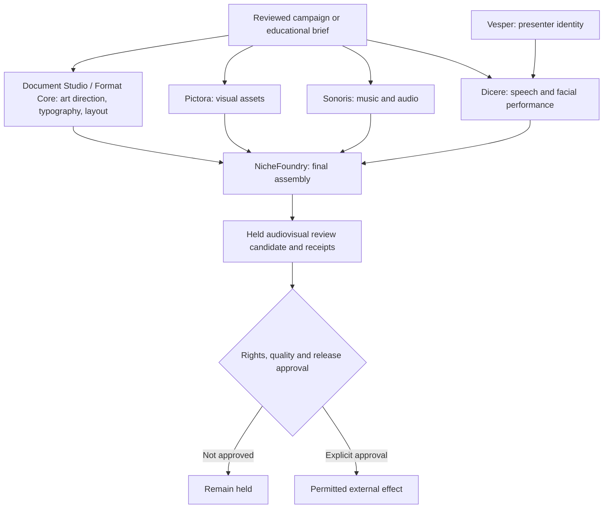
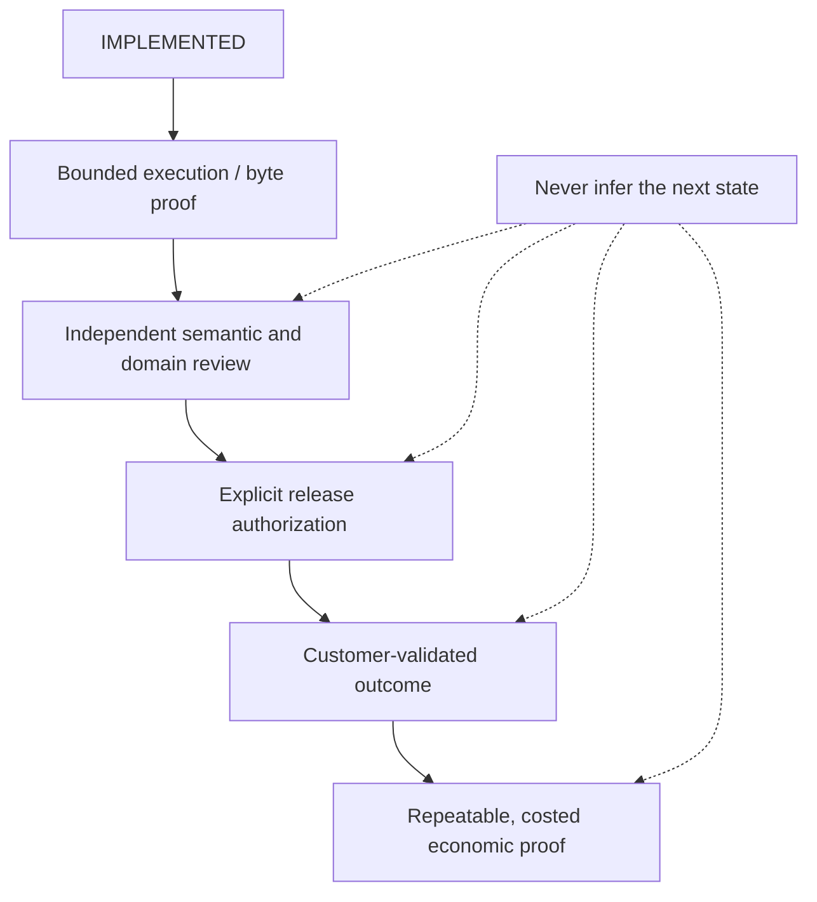

# DIO | Deterministic Intelligence Orchestration

<p align="center">
  
</p>

<p align="center"><strong>A governed, proof-carrying intelligence organism for turning human intent into useful professional work.</strong></p>

DIO combines specialist intelligence, deterministic software, local creative engines, product composition, evidence custody and human authority. It is neither a single AI model nor 68 isolated apps. It is a system for making intelligence **composable, inspectable and accountable**.

> **Quality first. Commercial conversion second. Architecture serves both.**
>
> A technically successful workflow is not necessarily a correct answer, a useful product, an accepted delivery or a viable business.

**State of this documentation: 4 November 2026.** This page distinguishes architectural doctrine, implemented code, bounded demonstrations and independently validated outcomes. No single “ready” label substitutes for those distinctions.

[Start a product locally](#run-a-customer-product) · [Explore the organs](#the-organs-and-their-boundaries) · [See compositions](#integration-and-cross-composition) · [Inspect proof](#evidence-and-current-qualification) · [Understand the philosophy](#the-philosophy)

---

### The governed consequence loop

This is the intended architectural relationship, not a claim that every boundary is live on every host.



## The philosophy

DIO's organizing question is not simply *“Can AI make this?”* It is:

> **What was requested? What evidence was supplied? What is known versus inferred? Which capability actually ran? What did it produce? What remains uncertain? Who can approve the next action? And what did the real world ultimately confirm?**

That leads to five design commitments.

**1. Intelligence should do consequential work, not merely sound plausible.** An answer becomes useful when it supports a specific task, respects its sources and uncertainty, and survives review. A beautiful artifact with wrong reasoning is still wrong.

**2. Proof must travel with the work.** DIO attempts to preserve source identity, hashes, execution receipts, review findings, provenance and release status. A hash proves which bytes were used, **not** whether the claim inside those bytes is true.

**3. Composition should multiply capability without multiplying permission.** One organ can serve many products; a Studio can become a component of another Studio; a verified pattern may be reused. But role changes do not grant new access or authority. The constitutional law is **metamorphosis never implies authority promotion**.

**4. Refusal is a valid, often necessary result.** When evidence, permissions, competence or a local runtime are missing, the correct output can be `UNKNOWN`, `NEEDS_YOU`, `HOLD` or `REFUSE`. DIO must not fabricate a provider, citation, qualification, approval, transaction or successful test to complete a narrative.

**5. The customer is outside the proof loop until real evidence arrives.** Passing tests demonstrates a bounded implementation property. It cannot manufacture buyer acceptance, willingness to pay, trustworthy professional advice or repeatable profit.

These are **normative design laws**. Their implementation is uneven across subsystems and must be assessed at each actual execution boundary. The fuller doctrine is in the [Metamorphic Cascade Canon](docs/DIO_METAMORPHIC_CASCADE_CANON.md).

### The distinctions that keep the organism honest

| Do not confuse | With |
|---|---|
| Plan or model output | Executed capability |
| Execution | Permission to disclose, send, publish or spend |
| Byte integrity and source fidelity | Substantive truth or domain competence |
| Reviewable professional draft | Independent professional sign-off |
| Successful local test | Safe deployment or customer acceptance |
| Controlled payment event | Real revenue, fulfilment or value |
| Domain analogy | Verified execution-grade capability |
| Learning and reusable patterns | Authority to act |
| Product catalog entry | Released sellable product |

A central invariant runs throughout the project: **evidence can justify a proposal, but only the appropriate authority can permit an effect.**

---

## What DIO is becoming

DIO's original product-factory concept is now only part of its architecture. The wider ambition is a **governed consequence loop**: take human intent, resolve the right specialist capabilities, execute within constraints, evaluate the artifact, hold or authorize subsequent effects, observe outcomes, and learn without self-escalation.

```text
HUMAN / CUSTOMER INTENT
       |
       v
VESPER + LINGUA            interaction, intake, semantic custody
       |
       v
PRODUCT / META COMPOSITION declared needs, profiles, native providers, bounded scope
       |
       +----> HOMS / SOPHIA / EVIDEX / VAMP / DOCUMENT STUDIO / ...
       +----> PICTORA / SONORIS / DICERE / FORMAT CORE / NICHEFOUNDRY
       |
       v
EXECUTED OUTPUTS           documents, analysis, lessons, images, music, media
       |
       v
PROOF + QUALITY            receipts, source binding, checks, review and repairs
       |
       v
AUTHORITY BOUNDARY         explicit approval for consequential effects
       |
       v
WORLD / CUSTOMER OUTCOME   acceptance, delivery, measured value, or refusal
       |
       v
LEARNING / RECOMPOSITION  improve future proposals, never auto-grant permission
```

This is an **architectural map**, not a claim that every arrow is implemented as one universal production runtime. Cross-organ connections below identify what has actually been demonstrated and what remains a designed or locally dependent path.

### The Metamorphic Cascade

A governed unit may occupy different roles at different scales:

```text
organ -> capability -> product -> Studio -> reusable pattern / crystal
                         \                         /
                          -> composite product <--
                                      |
                               customer-facing service
```

The useful part is **recursive reuse**: a verifier can become an assurance service; a document Studio can format another product's output; one creative organ's asset can become another product's input. Each composition still needs typed inputs and outputs, an identified executor, evidence and quality contracts, maturity limits and explicit authority. See the [canonical architecture doctrine](docs/DIO_METAMORPHIC_CASCADE_CANON.md).

---

#### Metamorphic roles, not automatic promotions



**Invariant:** role transitions are possibilities for reuse, not grants of maturity, capability or authority.

## The organs and their boundaries

An **organ** is a specialist part of the organism. “Organ” does not mean every capability is a separately deployable service or an independently cleared commercial product.

| Organ / subsystem | What it contributes | What it must not silently claim |
|---|---|---|
| **Vesper** | Customer-facing presenter and interaction surface; intake and performance identity | That being on screen means it generated speech, music or finished the video |
| **Dicere** | Speech articulation, facial motion, lip synchronization and audiovisual performance | Universal real-time animation or approved long-form presenter performance |
| **Sonoris** | Music composition experiments, genre/gesture grammar, audio rendering and soundtrack candidates | Cleared sample rights, general prompt-to-song ability or professional mastering |
| **Pictora** | Local image generation, editing, inpainting, conditioning, visual candidates and refinement | Factual image correctness, identity perfection or cleared model/asset rights |
| **Document Studio / Format Core** | Editorial transformation, art direction, typography, layout, accessible-oriented and format-specific projection | Source correctness or professional sign-off merely because the result looks polished |
| **NicheFoundry** | Governed final assembly of campaigns and media from approved components | Sole authorship of visuals, narration or composition; publication authority |
| **HOMS** | Exam, assessment, moderation, curriculum and learning workflows | Autonomous educator judgment or classroom-ready assessments without moderation |
| **Sophia** | Scholarly review, source-grounded research and academic/learning support | Authorship substitution, guaranteed citation truth or scholarly approval |
| **Evidex** | Evidence intake, reconciliation preparation, traceability and proof packs | That an underlying claim is true because its record is organized |
| **VAMP** | Performance, achievement, CPD and evidence-mapping preparation | Unreviewed ratings, promotion decisions or accepted professional evidence |
| **Lingua** | Semantic/language preservation, translation and professional expression | Proficient human-language sign-off from an automated draft |
| **META / product compiler** | Reusable evidence, obligation, assurance and work-pattern composition | A product route becoming authorized solely because it was compiled |
| **BEAST / reusable compute** | Bounded compute, verified reuse and exploratory crystallization | Learned authority or unreviewed host mutation |
| **ATLAS** | Cross-domain discovery and candidate capability mapping | Analogy or domain coverage becoming an execution-grade signature |
| **GoldenEye / operator surfaces** | Read-only or governed projection of product, runtime and commercial state | An observation dashboard granting maturity, release or approval |
| **Seraph / Triune / Valinor / Arda** | Challenge, governance assessment and sovereign/attested execution boundaries as defined by DIO's doctrine | Any reviewer, test or model bypassing the actual authority chain |

The last row describes **architectural roles**, not an assertion that the entire sovereign stack is enabled and enforcing on every host. Local availability and attestation must be proven for the precise runtime and effect. [Metamorphic governance canon](docs/DIO_METAMORPHIC_CASCADE_CANON.md) · [Creative organ registry](config/creative_organs.json).

### Creative production responsibility map



The creative lanes retain separate authorship. **NicheFoundry assembles**; it does not become the origin of all component media. The diagram shows responsibilities, not blanket production release.

### The new creative organs are real, but differently mature

**Pictora.** The DIO adapter binds locally supplied ComfyUI workflows, source images, selected checkpoints and receipts. The local studio documents generate, image-to-image, masked inpaint, pose/identity/composition references and deterministic editing controls. Recorded demonstrations include a mask-guided medallion edit and a multi-reference render. Exact identity, arbitrary workflow success and commercial rights remain unresolved. [Pictora editor](docs/PICTORA_IMAGE_EDITOR_PRODUCT.md) · [DIO integration](docs/PICTORA_VISUAL_STUDIO_INTEGRATION.md).

**Sonoris.** The local composition work includes genre grammar, riff/gesture and arrangement models, SFZ/instrument routing, generated seed renders, named editing recipes, authored **Glass Meridian** jazz-synth experimentation and metal/darksynth render candidates. These are substantive audio experiments, not just soundtrack selection. Musical approval, license clearance, mix/master standards and general-purpose autonomous composition are separate gates. [Genre compiler](docs/SONORIS_GOVERNED_GENRE_COMPILER_V1.md) · [integration handoff](docs/DIO_SONORIS_PICTORA_INTEGRATION_HANDOFF.md).

**Dicere.** The local performance path binds Vera speech to Vesper's moving-face/lip-sync candidates using MuseTalk, LivePortrait and local video composition. The performance compiler also maps supplied phoneme timing into frame-indexed mouth controls. The existence of a rendered explainer does not mean every source portrait, viseme, expression or long-form take is solved. [Performance compiler handoff](docs/VESPER_PERFORMANCE_COMPILER_HANDOFF.md).

The roles are deliberately non-overlapping: **Vesper presents; Dicere performs; Sonoris scores; Pictora creates visual assets; Document Studio / Format Core directs layout and composition; NicheFoundry assembles the finished media.** A component may be reused elsewhere, but its authorship and assurance obligations remain traceable.

---

## Integration and cross-composition

The most important recent change is **composition across product families**, not the number of new names in the catalog. The following are examples anchored in source modules, local execution receipts and November 4 handoffs.

| Composition | Current demonstrated boundary | Still required |
|---|---|---|
| **HOMS Exam -> curriculum spine -> Learning Studio -> Assess** | Shared source/hash-bound curriculum spine, exam/memo/learner and educator review projections; Assess validates linked paper and memo inputs | Expert checking of marks, reasoning, curriculum coverage, pedagogy and classroom release |
| **Pictora -> HOMS / Format Core / Accessible Publish / Site Studio** | Existing local visual candidates attached to review HTML, with hashes and *decorative-only* semantics where appropriate | Factual/educational accuracy, accessibility, image rights and human approval |
| **Sonoris -> campaign music resolver -> NicheFoundry** | Explicit local Sonoris review selections can supply a media soundtrack; audio/video outputs and selection are receipt-bound | Sonic approval, sample rights, campaign consent, release permission |
| **Pictora + Sonoris + Vera + NicheFoundry** | Local combined campaign-media demonstration produced landscape and vertical renders from visual, music, narration and DIO design assets | Repeatable customer brief-to-delivery acceptance, rights and publication gates |
| **Dicere + Vesper + Vera** | Local presenter performance and short explainer candidates; separate phoneme/viseme and motion experiments | Long-form stability, expression quality and audiovisual QA |
| **Sophia + evidence/document outputs** | Source-bound scholarly review routes into held document and customer-review surfaces | Domain acceptance, citation verification and user outcome evidence |
| **Evidex + VAMP / readiness families** | Evidence records and source traces inform bounded review and reconciliation products | Authentication of real underlying records and competent professional interpretation |
| **AI Trust + Seraph telemetry** | Case-scoped hash-chain verification is recorded in challenge/proof receipts for applicable AI Trust and RegOps paths | Exporter authentication, signatures, monitoring continuity and actual external system assurance |
| **ATLAS -> Sonoris/Pictora domain discovery** | 23 editorial candidate domains (18 Sonoris, 22 Pictora, 17 shared) are explicitly mapped | **Zero execution-grade creative signatures** in this crosswalk; domain analogy grants no execution |
| **Customer product -> Format Core -> held review** | Shared production finishing and product-specific output packages where implemented | Semantic accuracy, professional presentation acceptance and product release |

The precise implementation and qualification records are in [the November 4 reconciliation](docs/reconciliation/2026-11-04-worktree-reconciliation.md), [HOMS handoff](docs/HOMS_EXAM_TO_LEARNING_STUDIO_HANDOFF.md), [Pictora integration](docs/PICTORA_VISUAL_STUDIO_INTEGRATION.md), [creative handoff](docs/DIO_SONORIS_PICTORA_INTEGRATION_HANDOFF.md), and [Seraph telemetry assessment](docs/AI_PROOF_SERAPH_TELEMETRY.md).

### Why cross-composition matters

A standalone image generator outputs an image. A governed **HOMS + Pictora + Document Studio** path can instead ask for an illustration attached to a particular lesson and source, show it in the teaching document, retain its origin and require a teacher to accept it. Similarly, **Sonoris + Dicere/Vesper + Pictora + NicheFoundry** can transform a reviewed message into a composed audiovisual candidate without pretending one organ performed every step.

This is the promise of DIO's design: **specialization without silos, reuse without identity loss, and composition without automatic authority escalation**. Whether it improves cost, speed or quality must still be measured against alternatives on real tasks.

---

## Products, Studios and the factory

The canonical customer catalog currently contains **68 named offers**. They include education, academic integrity, evidence/assurance, enterprise readiness, financial/funding preparation, obligation and regulated-market review, document/publishing, communication and creative-market services.

A **product** is a bounded customer job with stated inputs, outputs and review conditions. A **Studio** can provide richer interactive work, editing and revision, or a composite environment. Some product/Studio pairs still share the same selected proof artifact; distinct commercial value and independent quality evidence remain work to do.

DIO's phase-derived factory composes typed profiles, product manifests, work patterns, obligation/evidence primitives, native executors and proof receipts. The historical Phase 0–16.1 work established constitution/compiler, obligation families, META runtime, GoldenEye, commercial-truth classification, controlled paid-reference journeys, self-expanding product materialization and media-incarnation demonstrations. A **phase-specific `READY` token describes a bounded acceptance**, never general release readiness.

### The two portfolio scopes are different

- **53 canonical incarnations:** the historical professional-evidence gauntlet's explicit baseline scope and acceptance token. See [its contract](docs/PROFESSIONAL_EVIDENCE_PORTFOLIO_GAUNTLET.md).
- **68 named customer offers:** the newer customer-packet catalog and qualification ledger. There are currently explicit packet contracts and declared full-pipeline routes for all 68. See [the source-driven runbook](docs/customer_products/RUNBOOK.md) and [qualification assessment](docs/audits/2026-10-27-sellable-product-pathways.md).

Neither denominator means all outputs are professionally approved or commercially validated.

---

## Evidence and current qualification

**Qualification snapshot reported in the repository on 4 November 2026:**

| Recorded measure | Scope and meaning |
|---|---|
| **68/68** | Configured customer packet contracts and reported bounded full-pipeline routes |
| **56** | Held execution offers, not automatically pilot-sellable |
| **12** | Bounded paid-pilot candidates requiring human review; nine underlying capabilities |
| **5,459** | Declared evidence artifacts in the current local qualification ledger; integrity and presence, not substantive truth |
| **0/68** | Independent professional sign-offs |
| **0** | Release authorizations earned by the portfolio snapshot |

The [curated November 4 proof portfolio](deliverables/product_proof_portfolio_20261104.zip) selects one primary reviewable artifact per offer with product evidence where available and a separate Pictora/Sonoris/Dicere appendix. Selection is for **reviewability**, not expert scoring. Some Studio offers share primary artifacts. Document Studio Edit uses a clearly labelled historical fallback because no in-window selected artifact qualified. The archive does not constitute buyer acceptance.

**HOMS exam bundle (earlier randomized selection).** The [saved Grades 1–12 candidates](deliverables/homs_best_randomized_exam_candidates_20261104_v2/README.md) have draft paper/memo pairs, educator review sheets and hashes. Educator decisions remain blank. The older Grade 12 randomized selection was a **50-mark focused assessment**, not a comprehensive CAPS examination; the separate newer two-paper Business Studies draft is described below. Neither is classroom-authorized.

### November 4 qualification additions

Grades 1–11 remain the saved randomized draft candidates. Grade 12 now also has a complete two-paper Business Studies candidate: Paper 1 covers Business Environments and Business Operations; Paper 2 covers Business Ventures and Business Roles. Each paper is 150 marks over 120 minutes, with the DBE-style Section A / choose-two Section B / choose-one Section C structure. Open the [Grade 12 review package](deliverables/homs_grade12_business_studies_full_nsc_candidate_20261104/README.md) or its [ZIP](deliverables/homs_grade12_business_studies_full_nsc_candidate_20261104/HOMS_GRADE12_FULL_NSC_CANDIDATE.zip). These are original practice drafts, not official DBE papers. Educator item decisions and independent moderation are still outstanding; classroom release is not authorized. The [customer product runbook](docs/customer_products/RUNBOOK.md) explains the assessment route and review gates.

The refreshed [portable product proof portfolio](deliverables/product_proof_portfolio_20261104.zip) also includes an [Evidex synthetic claim-to-record truth benchmark](deliverables/evidex_claim_truth_benchmark_20261104/EXPERT_REVIEW_RUBRIC.md), with raw source fixtures, a reference adjudication, output comparison and adversarial review criteria. It is a controlled benchmark, **not** independent acceptance of real customer claims.

### Independent product readiness verdicts

The archive includes independent execution, output-quality, evidence-validity, customer-acceptance and release verdicts. Open the standalone [JSON report](deliverables/product_readiness_verdicts_20261104/PRODUCT_READINESS_VERDICTS.json) or [CSV](deliverables/product_readiness_verdicts_20261104/PRODUCT_READINESS_VERDICTS.csv), also bundled in the [proof portfolio archive](deliverables/product_proof_portfolio_20261104.zip). The current 68-offer snapshot records **68 execution PASS**, **68 output-quality UNVERIFIED**, **67 TRACEABLE_UNVALIDATED evidence sets** and one evidence set without a product receipt, **68 customer-acceptance UNVERIFIED**, and **68 release HELD**. A traceable receipt proves lineage and byte identity; it does not establish that the conclusion is right. `NOT_ESTABLISHED` is the professional-readiness result for every offer until independent output scoring, source-validity review, customer acceptance and release evidence exist.

**Campaign Lab.** Its caption package adds SRT and WebVTT tracks for landscape and vertical outputs. The cues follow source narration/scene durations, **not phoneme-accurate forced alignment**; review remains required. [Caption receipt](deliverables/campaign_lab_caption_sidecars_20261104/README.md).

**Testing.** The preserved broader qualification audit records **2,188 passes, 94 failures, 16 errors and five skips**, plus subtest results, for a historical full-repository snapshot. That is **not a green full suite**. The November 4 reconciliation explicitly says it did **not** rerun the whole suite. A recent success claim must specify the exact command, commit, environment and receipt; do not silently replace these recorded results with isolated per-product passes.

**Local evidence versus GitHub evidence.** Some linked/generated acceptance files and Sonoris/Pictora/Dicere runtime assets reside in the operator's local workspace and are not bundled into a fresh clone. An absolute `/data/byron/...` path is a machine-specific reference, not a portable installation instruction. The portable proof archive is a selected evidence package, not the full multi-gigabyte local workspace.

### Readiness is a ladder, not a badge



DIO must never automatically infer a lower step's successor. The current portfolio is dominated by **held engineering proofs** and **bounded pilot candidates**, not the final two steps.

---

## Run a customer product

Use the exact repository checkout and its configured Python environment; system dependencies and local native engines vary by product.

```bash
# From the repository root
.venv/bin/python scripts/run_customer_product.py --catalog

# Example: supply a real schema-compliant Contract Desk packet
.venv/bin/python scripts/run_customer_product.py \
  --product "Contract Desk" \
  --packet /path/to/contract-desk-packet.json \
  --out /tmp/dio-contract-desk-review
```

Relative source-file paths in the supplied packet are resolved against the packet's directory for supported attachment fields. Outputs are review drafts; the command does not send, file, certify or publish. Review the [customer runbook](docs/customer_products/RUNBOOK.md) for each offer's schema, supplied inputs, prerequisites and expected output set. Do not process someone else's confidential material without authorization.

To **rebuild the existing qualification view from recorded evidence**, rather than rerunning all products:

```bash
.venv/bin/python scripts/build_customer_product_qualification.py
```

To inspect creative engines without executing an unauthorized job:

```bash
python3 scripts/run_dio_creative_organs.py --catalog
python3 scripts/run_dio_creative_organs.py --sonoris-preflight
python3 scripts/run_dio_creative_organs.py --pictora-discover
```

Pictora's default ComfyUI endpoint is local loopback (`127.0.0.1:8188`). Sonoris may depend on the separate `/data/byron/sonoris` workspace and installed audio tools. [Creative setup and explicit job examples](docs/DIO_SONORIS_PICTORA_INTEGRATION_HANDOFF.md).

### Local operator interfaces

```bash
.venv/bin/python scripts/serve_business_workbench.py \
  --host 127.0.0.1 --port 8767 --market-port 8771

# In another terminal
.venv/bin/python scripts/serve_market_command_ms10.py \
  --host 127.0.0.1 --port 8771 --business-port 8767
```

These are **local operator surfaces**, not automatically secured public deployments. The historical GoldenEye view can be served with `python scripts/serve_goldeneye_portfolio.py`. See the existing [runbook](docs/customer_products/RUNBOOK.md) before choosing a product execution or external-facing workflow.

### Verify a historical professional-evidence run

```bash
PYTHONNOUSERSITE=1 .venv/bin/python scripts/run_professional_evidence_portfolio.py \
  --output state/professional_evidence/portfolio_v1 \
  --online --strict
```

This is the distinct **53-incarnation gauntlet**, not the entire 68-offer qualification process. `--online` can access external sources and therefore should be used only with an appropriate network, consent and source policy. The run's actual result must be inspected; the presence of a documented acceptance token does not mean it just passed in your environment.

---

## Governance and non-negotiable limits

DIO models a separation between **assessment**, **execution identity** and **permission**. Its constitutional docs assign sovereign runtime authority to Valinor, measured execution/attestation to Arda, and challenge/assessment roles to Seraph and wider governance. None of those names, or a favourable model output, alone proves that the boundary is active on the reader's machine.

Real-world actions such as sending correspondence, publishing media, moving money, accessing customer systems, filing legal or regulatory submissions, issuing consequential educational judgments or authorizing spending require separately verified identity, policy, rights and human approval. Legal, tax, accounting, medical and other regulated interpretations remain with qualified people where applicable.

The commercial-truth layer likewise separates offers, interest, controlled payments, verified payments, fulfilment, accepted delivery, customer value, repeatability and positive same-currency economics.

**Never commit:** credentials, private keys, customer records without authorization, model/source assets without rights clearance, or generated personal data. Runtime receipts must not leak secrets through logs or public sites.

---

## Repository map and source of truth

| Location | Responsibility |
|---|---|
| `config/` | Product manifests, source contracts, profiles, creative organ and genre registries |
| `products/` | Product runners, native/composite execution, review and organ adapters |
| `adapters/` | Interfaces to specialist engines, document, linguistic and assurance processors |
| `presence_core/` | Customer journey, intake and operator production coordination |
| `obligation/`, `evidence/`, `schemas/` | Shared obligations, evidence semantics and contracts |
| `atlas/` | Domain discovery and candidate mappings, not automatically certified capability |
| `dashboard/` | Local operator, product and customer-review surfaces |
| `scripts/` | Operator commands, validators, renderers, gauntlets and packagers |
| `docs/` | Doctrine, implementation handoffs, audits, limitations and acceptance guidance |
| `deliverables/` | Selected portable examples and review packages; not the entire local media archive |
| `state/`, `telemetry/`, `acceptance_runs/` | Local generated state and evidence where present, not necessarily tracked artifacts |

Important reading: [Metamorphic philosophy](docs/DIO_METAMORPHIC_CASCADE_CANON.md) · [Customer qualification](docs/audits/2026-10-27-sellable-product-pathways.md) · [November 4 reconciliation](docs/reconciliation/2026-11-04-worktree-reconciliation.md) · [Creative integration](docs/DIO_SONORIS_PICTORA_INTEGRATION_HANDOFF.md) · [HOMS learning handoff](docs/HOMS_EXAM_TO_LEARNING_STUDIO_HANDOFF.md) · [AI/Seraph scope](docs/AI_PROOF_SERAPH_TELEMETRY.md).

---

## The thesis

DIO is an attempt to make a difficult promise practical:

**Intelligence should be able to compose across disciplines, improve through evidence, and produce work worth paying for, without confusing its imagination with its competence or its success with its permission.**

The system's value will not ultimately be proven by the number of organs, phases, routes or generated artifacts. It will be proven when independent reviewers and real customers find its outputs **accurate, useful, traceable, better than reasonable alternatives and economically repeatable**.

Until then, DIO should keep building, testing, correcting, and recording exactly what it knows.

**Compose boldly. Prove narrowly. Authorize explicitly.**
